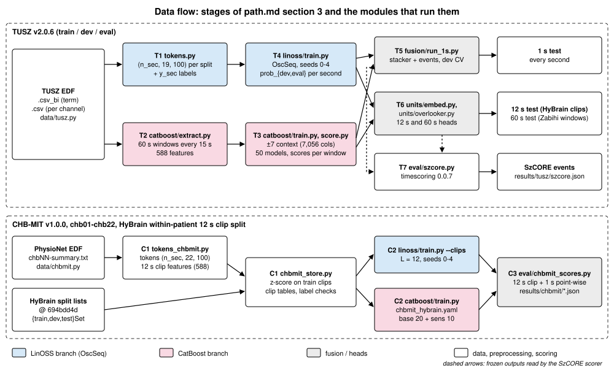
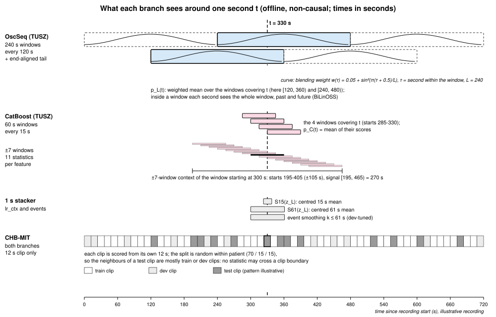
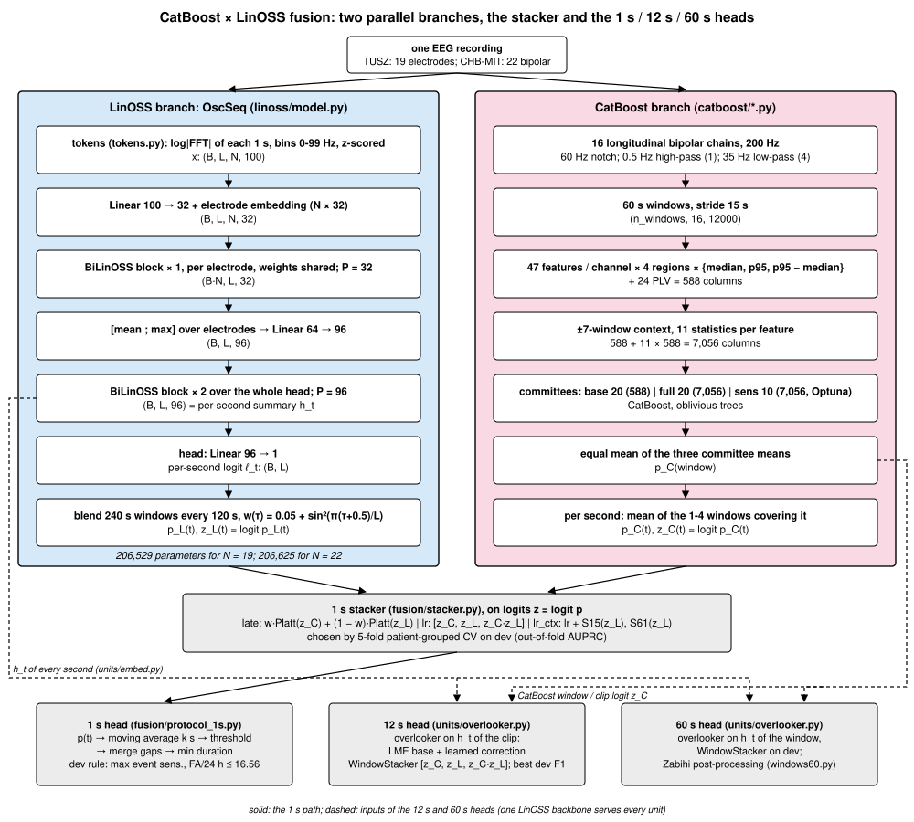

# CatBoost × LinOSS fusion: technical documentation

This document describes the CatBoost × LinOSS fusion for EEG seizure detection as it is implemented in this
repository. It covers the TUSZ v2.0.6 and CHB-MIT protocols, the architecture, the formulas, the algorithms, the
protocols and how to reproduce the results.

**How to read this document.**
- Each statement about the method cites the code that implements it, as `path/file.py:function` (paths relative to
  `src/szfusion/` unless they start with `configs/`, `kaggle/` or `scripts/`), or it cites a paper (section 10).
- Results are not final yet. Each place where a result belongs holds a visible placeholder of the form
  `⟦RESULT: what, from which file⟧`. Each number that later replaces a placeholder must be copied from a file in
  `results/` that the code produced (RULES.md 6).
- A few numbers are quoted from the development run of 2026-10-14. They appear only inside boxes labelled
  **Development run (reproduced exactly by this code, PROGRESS.md S1)**. They show that the code is a faithful port.
  They are not the official results.
- Published baselines are copied from the cited papers. Section 10 says how each one was checked.

Contents:
1. Overview
2. What "context" means
3. Architecture
4. Formulas
5. Why fusion
6. Algorithms
7. Protocols
8. Reproduction guide
9. Decisions log
10. References

Appendix: placeholders for results and figures.

---

## 1. Overview

**The task.** Find seizures in long scalp-EEG recordings, offline. Offline means the whole recording is available
when it is scored. The detector gives three outputs:
- a seizure probability for every second;
- seizure events (onset and offset in seconds);
- a score for each 12 s clip and each 60 s window. These exist so that the system can be compared with published
  work that uses those units.

**The system.** The CatBoost × LinOSS fusion has two parallel branches and a logistic stacker (path.md §1):
- **The LinOSS branch, OscSeq.** It reads one spectral token per second and outputs one logit per second
  (`linoss/model.py:OscSeq`).
- **The CatBoost branch.** It reads hand-crafted features of 60 s windows and outputs one probability per window
  (`catboost/train.py:train`, `catboost/score.py:score_split`). That probability is spread to the seconds the
  window covers (`fusion/protocol_1s.py:catboost_track`).
- **The stacker.** It fuses the two per-second scores (`fusion/stacker.py:Stacker`).
- **Three read-outs** of the fused system:
  - 1 s: every second;
  - 12 s: clips;
  - 60 s: windows every 15 s.

  The 12 s and 60 s read-outs use small "overlooker" heads on the LinOSS per-second summaries
  (`units/overlooker.py`).

**Datasets and protocols.**

| Dataset | Split | Tests |
|---|---|---|
| TUSZ v2.0.6 [Shah 2018] | train / dev / eval as distributed; eval is the test set | **1 s test**, **12 s test** (the HyBrain authors' clip lists), **60 s test** (the windows, labels and event rule of Zabihi et al. 2026), plus SzCORE event scoring of the frozen outputs |
| CHB-MIT Scalp EEG v1.0.0 [Shoeb 2009; Goldberger 2000] | chb01–chb22 under the HyBrain protocol [Kim 2026]: 12 s clips, a within-patient 70 / 15 / 15 split | 12 s clip detection and 1 s point-wise detection; compared with HyBrain's published numbers only |

**What the repository contains.**

| Folder | Contents |
|---|---|
| `src/szfusion/` | the package (one module per stage, see Figure 1) |
| `configs/` | `paths.yaml` (local locations, git-ignored), `tusz_final.yaml` (CatBoost on TUSZ), `chbmit_hybrain.yaml` (CatBoost on CHB-MIT) |
| `kaggle/` | kernel templates for the GPU stages and the CHB-MIT download / preprocessing |
| `scripts/kaggle_push.py` | stages the private Kaggle datasets and pushes the kernels |
| `tests/` | unit and regression tests |
| `results/` | aggregate results only |
| `docs/` | this document and its figures |

The fixed plan is `path.md`. The append-only log of what was done and checked is `PROGRESS.md`.



**Figure 1. Data flow.** Stage names (T1–T7, C1–C3) are those of path.md §3. Blue: the LinOSS branch. Pink: the
CatBoost branch. Grey: fusion and heads. Generated by `src/szfusion/viz/diagrams/make_diagrams.py`.

---

## 2. What "context" means

"Context" means the signal around a second (or clip, or window) that the model may read when it scores it. Both
branches are **offline and non-causal**: they read the future as well as the past. Figure 2 draws all the context
lengths below on one time axis.



**Figure 2. What each branch sees around one second t.** The recording and the split pattern of the CHB-MIT row are
illustrative. Every length drawn is a constant of the code; `make_diagrams.py --check` asserts this.

### 2.1 The LinOSS branch on TUSZ: 240 s windows every 120 s, blended

**Training** uses segments of L = 240 s (`linoss/data.py:TrainSegments`, `linoss/train.py:parse` `--L 240`).

**Scoring.** A recording is cut into windows of L = 240 s every S = 120 s, plus one extra window aligned to the end
of the recording, so that every second is covered (`linoss/data.py:RecordingWindows`, `--final_stride 120`).
- Inside a window, every second sees the whole window, past and future. This is because each BiLinOSS block runs a
  forward and a time-reversed LinOSS layer (`linoss/model.py:BiLinOSSBlock`).
- A second is covered by one to three windows.
- Their probabilities are averaged with the weight

  $$w(\tau) = 0.05 + \sin^2\!\big(\pi(\tau + 0.5)/L\big),$$

  where τ = 0, …, L − 1 is the position of the second inside the window (`linoss/data.py:RecordingWindows.blend`).
- The weight is 0.05 at the window edges and 1.05 at the centre. It down-weights the seconds whose bidirectional
  context is one-sided.

**Reach.** The per-second LinOSS probability p_L(t) depends only on tokens inside the windows that cover t. So it
depends on tokens at most 239 s before or after t.

**Per-epoch dev selection** uses windows of 240 s every 240 s, plus the end-aligned window. The final dev and eval
tracks use the 120 s stride (`linoss/train.py:main`, `dev_win = RecordingWindows(st_dev, a.L, a.L, sub)`).

### 2.2 The CatBoost branch on TUSZ: 60 s windows every 15 s, ±7-window statistics

- Each window covers 60 s of signal. Windows start every 15 s (`configs/tusz_final.yaml` `win_sec: 60`,
  `stride_sec: 15`; `data/tusz.py:window_recording`).
- **With context**, each base feature of window i gets 11 statistics computed over the centred run of windows
  i − 7 … i + 7, truncated at the recording edges (`catboost/context.py:_file_context`, `k: 7`).
  - Those windows start up to ±105 s (7 × 15 s) from window i.
  - Together they span 270 s of signal: from 105 s before the start of window i to 165 s after it.
- The CatBoost probability of a second is the mean over the 1–4 windows that cover it
  (`fusion/protocol_1s.py:catboost_track`). Those windows start in (t − 60, t], and their context windows reach
  (t − 165, t + 165]. So **p_C(t) depends on signal at most 165 s before or after t.**
- **Without context** ("clip-only" or "window-only"), each window is described by its own 588 features
  (`catboost/context.py:maybe_context` with `mode: none`).

### 2.3 Context added after the branches

**The 1 s stacker.** The `lr_ctx` candidate adds S₁₅(z_L) and S₆₁(z_L): centred 15 s and 61 s moving means of the
LinOSS logit, computed within the recording (`fusion/stacker.py:feats`, `fusion/protocol_1s.py:smooth`). They extend
the LinOSS reach by up to 30 s on each side.

**The 1 s event rule.** It smooths the fused probability with a centred moving average of k ∈ {1, 5, 15, 31, 61}
seconds before thresholding (`fusion/protocol_1s.py:GRID`, `tune_events`).

**The 12 s and 60 s tests on TUSZ** read the per-second LinOSS summaries h_t (section 3). These were computed from
the same 240 s windows (`units/embed.py:main`). They also read the CatBoost window scores with ±7 context
(`units/overlooker.py:eval_windows`). So **on TUSZ the 12 s and 60 s outputs are "with context"**: a 12 s clip is
scored with up to 240 s of LinOSS context and up to ±165 s of CatBoost context around it. The comparison with
HyBrain's 12 s numbers is therefore a system-level comparison, not a matched-input one (section 7.1).

### 2.4 CHB-MIT: both branches are clip-only, and why

Under the HyBrain protocol, each patient's 12 s clips are split at random within the patient into 70 / 15 / 15 %
train / dev / test, shuffled with seed 123 (`chbmit_store.py` docstring; [Kim 2026], which follows the EvoBrain
protocol [Kotoge 2025]). So the neighbours of a test clip are, in most cases, train or dev clips of the same
recording.

Context across clips would cause two kinds of leakage:
- **Through the features.** A statistic over neighbouring clips, or an SSM window spanning several clips, would read
  training-clip signal when it scores a test clip.
- **Through the labels.** Seizure labels are strongly correlated in time, so a test clip's neighbours are
  informative about its label.

path.md §4.7 therefore fixes "each 12 s clip is seen alone, by both branches":
- **LinOSS** is trained only on listed train clips, with L = 12 (`linoss/data.py:ClipSegments`). It scores each
  listed dev or test clip from its own 12 s (`linoss/data.py:ClipWindows`). `linoss/train.py:main` requires
  `--L 12` in clip mode.
- **CatBoost** features are computed on the 12 s clip itself (`tokens_chbmit.py:process`). There is no context
  (`configs/chbmit_hybrain.yaml` `context: mode: none`; `catboost/context.py:maybe_context`).
- The z-score of the CHB-MIT tokens is fitted on the train clips only (`chbmit_store.py:main`).

---

## 3. Architecture



**Figure 3. Two parallel branches, the stacker and the three heads.** Light blue: the LinOSS branch (OscSeq). Light
pink: the CatBoost branch. Dashed: the per-second summaries h_t and the CatBoost window or clip logits that the 12 s
and 60 s heads read. A single LinOSS backbone serves every unit.

### 3.1 The LinOSS branch (OscSeq), layer by layer

Notation:
- B: batch;
- L: seconds per segment (240 on TUSZ, 12 on CHB-MIT);
- N: input channels (19 referential electrodes on TUSZ, 22 bipolar channels on CHB-MIT);
- P: oscillators per LinOSS layer and direction.

Default configuration (`linoss/model.py:OscSeq.__init__`): n_bins 100, e_dim 32, p1 32, n1 1, H 96, p2 96, n2 2,
IM discretisation, dropout 0.1. The final recipe sets osc_periods = (5, 240) (`linoss/train.py:parse`
`--model '{"osc_periods": [5, 240]}'`).

| # | Layer (code) | Output shape | Parameters (N = 19) |
|---|---|---|---|
| 0 | input tokens, z-scored log\|FFT\|, 1 Hz bins 0–99 (`tokens.py`) | (B, L, N, 100) | — |
| 1 | `front`: Linear(100 → 32), shared over electrodes | (B, L, N, 32) | 3,232 |
| 2 | `el_emb`: electrode embedding, added; zero-initialised | (B, L, N, 32) | 608 (= 19 × 32) |
| 3 | reshape: one sequence per electrode | (B·N, L, 32) | — |
| 4 | `el_blocks`: 1 BiLinOSS block, H = 32, P = 32 per direction, weights shared over electrodes | (B·N, L, 32) | 10,496 |
| 5 | `pool`: [mean over electrodes ; max over electrodes], then Linear(64 → 96) | (B, L, 96) | 6,240 |
| 6 | `seq_blocks`: 2 BiLinOSS blocks, H = 96, P = 96 per direction | (B, L, 96) = per-second summary h_t (`OscSeq.features`) | 185,856 |
| 7 | `head`: Linear(96 → 1) | (B, L) per-second logit ℓ_t | 97 |
| | **total** | | **206,529** |

How the block totals are made up (verified by instantiating `OscSeq` and listing `named_parameters()`):
- One LinOSS layer has 4PH + 2P + H parameters: A_diag P, B 2PH, C 2PH, D H, steps P.
  - H = P = 32: 4,192 per layer.
  - H = P = 96: 37,152 per layer.
- A GLU has 2(H² + H) parameters: 2,112 for H = 32, 18,624 for H = 96.
- BatchNorm has no affine parameters.
- Hence 10,496 = 2 × 4,192 + 2,112 and 92,928 = 2 × 37,152 + 18,624 per sequence block (two blocks: 185,856).
- There are 6 LinOSS layers in all, with 2 × 32 + 4 × 96 = 448 oscillators.

**Parameter counts** (`sum(p.numel() for p in OscSeq(n_el=N, osc_periods=(5, 240)).parameters())`, computed for this
document):
- **206,529 for N = 19** (TUSZ);
- **206,625 for N = 22** (CHB-MIT). The difference is the embedding, 3 × 32 = 96.

The same count is logged by `linoss/train.py:main` (`log.event("model", params=…)`) and written to each run's
`results.json` (`"params"`).

**Electrode pooling.** The mean carries widespread activity and the max carries focal activity. Neither assumes a
seizure location (`linoss/model.py` module docstring).

**What the oscillators model.** The natural periods are initialised log-uniformly in 5–240 s at one token per second
(section 4.1). So the oscillators act on the slow evolution of the spectra over seconds to minutes. The EEG rhythms
themselves are already resolved by the FFT bins of the tokens (`linoss/model.py` module docstring).
- The learned periods are logged per epoch (`linoss/model.py:oscillator_report`) and saved in `results.json`.
- Learned periods: `⟦RESULT: learned oscillator period quantiles per layer, 5 seeds, results/tusz/linoss_seeds.json (from each run's results.json "oscillators")⟧`.

### 3.2 The CatBoost branch

**Signal conditioning** (`catboost/features.py:load_bipolar18`, `_filters`; `configs/tusz_final.yaml`
`catboost.data`):
1. The 19 referential electrodes are read without filtering (`data/tusz.py:load_eeg` `'ref19'`) and resampled to
   200 Hz with `scipy.signal.resample_poly`.
2. The 16 longitudinal bipolar chains are formed (`catboost/features.py:PAIRS16`): FP1-F7, F7-T3, T3-T5, T5-O1,
   FP2-F8, F8-T4, T4-T6, T6-O2, FP1-F3, F3-C3, C3-P3, P3-O1, FP2-F4, F4-C4, C4-P4, P4-O2.
3. The signal is scaled from µV to V.
4. Filters, all zero-phase:
   - 60 Hz notch, Q = 30;
   - 0.5 Hz Butterworth high-pass, order 1;
   - 35 Hz Butterworth low-pass, order 4.

**Windows** are 60 s long and start every 15 s (`data/tusz.py:window_recording`). A recording shorter than 60 s
gets no window (`data/tusz.py:n_windows`).

**Features.** Each window gets 588 features (section 4.6), plus 11 context statistics per feature: 588 × 12 = 7,056
columns.

**Committees** (`configs/tusz_final.yaml` `ensemble.members`; `catboost/train.py:train`):

| Committee | Columns | Models |
|---|---|---|
| base | 588 | 20 = 2 repeats × 10 patient-grouped folds |
| full | 7,056 | 20 = 2 × 10 |
| sens | 7,056 | 10 = 1 × 10, with Optuna-tuned parameters |

The window score is the equal mean of the three committee means (`catboost/score.py:score_split`).

**Per-second track.** The window score is spread to the seconds the window covers (`fusion/protocol_1s.py:catboost_track`).

### 3.3 The stacker

All stacker inputs are logits z = log(p / (1 − p)), with p clipped to [10⁻⁵, 1 − 10⁻⁵] (`fusion/stacker.py:logit`).

**1 s stacker** (`fusion/stacker.py:Stacker`). There are three candidates (section 4.7). One is chosen on dev by
5-fold patient-grouped cross-validation (`fusion/run_1s.py:select_fusion`).

**12 s / 60 s window stacker** (`fusion/stacker.py:WindowStacker`). It is a logistic regression on
[z_C, z_L, z_C·z_L], fitted on dev windows or clips.

### 3.4 The three heads

| Head | Input | Output | Code |
|---|---|---|---|
| 1 s | fused p(t) | per-second probability; events from smoothing, threshold, gap merging and minimum duration | `fusion/protocol_1s.py:events`, `tune_events` |
| 12 s | h_t of the 12 seconds of a clip, plus the CatBoost clip logit | clip probability; threshold = best dev F1 | `units/overlooker.py:Overlooker`, `units/clips12.py`, `fusion/stacker.py:WindowStacker` |
| 60 s | h_t of the 60 seconds of a window, plus the CatBoost window logit | window probability; the post-processing of Zabihi et al. gives events | `units/overlooker.py:Overlooker`, `units/windows60.py:tune`, `catboost/postprocess.py` |

**The overlooker** has 3,394 parameters, independent of N:
- LayerNorm(96): 192;
- Linear(96 → 32): 3,104;
- attention score Linear(32 → 1): 33;
- correction Linear(64 → 1): 65.

---

## 4. Formulas

### 4.1 The LinOSS layer [Rusch & Rus 2025] (`linoss/layer.py`)

**The model.** Each LinOSS layer drives P forced harmonic oscillators from an H-dimensional input u(t):

$$y''(t) = -A\,y(t) + B\,u(t), \qquad x(t) = \mathrm{Re}\big(C\,y(t)\big) + D \odot u(t),$$

where:
- A = diag(ReLU(â)) ≥ 0 (`LinOSSLayer.oscillators`);
- B ∈ ℂ^{P×H} and C ∈ ℂ^{H×P}, stored as real and imaginary parts (`B`: (P, H, 2), `C`: (H, P, 2));
- D ∈ ℝ^H;
- each oscillator has its own step Δt = σ(ŝ) ∈ (0, 1).

**Implicit (IM) discretisation**, used everywhere in this repository (`disc="IM"`). The state per oscillator is
s_n = (z_n, y_n), with z = y'. The update is s_n = M s_{n−1} + f (B u_n), with M and f exactly as in
`linoss/layer.py:_transition`:

$$M = \begin{pmatrix} S & -\Delta t\,A\,S \\ \Delta t\,S & S \end{pmatrix},\qquad
f = \begin{pmatrix} \Delta t\,S \\ \Delta t^{2}\,S \end{pmatrix},\qquad S = \frac{1}{1+\Delta t^{2}A}.$$

This follows from z_n = z_{n−1} + Δt(−A y_n + B u_n) and y_n = y_{n−1} + Δt z_n, solved for (z_n, y_n). The code
also implements the IMEX scheme (M = [[1, −ΔtA], [Δt, 1 − Δt²A]], f = (Δt, Δt²)), but no configuration uses it.

**Eigenvalues, damping and period.** M = S·[[1, −ΔtA], [Δt, 1]] has eigenvalues

$$\lambda = S\,(1 \pm i\,\Delta t\sqrt{A}), \qquad |\lambda|^2 = S^2(1+\Delta t^2 A) = \frac{1}{1+\Delta t^2 A} \le 1 .$$

So every IM oscillator is stable and damped. Per step it rotates by

$$\theta = \arg\lambda = \arctan\!\big(\Delta t\sqrt{A}\big), \qquad T = \frac{2\pi}{\theta}\ \text{steps},$$

and at one token per second T is the natural period in seconds. The code computes f = θ f_s / 2π with f_s = 1 Hz
(`LinOSSLayer.frequencies_hz`, `linoss/model.py:oscillator_report`). Damping and frequency are coupled: a larger
Δt√A gives both a shorter period and a stronger decay.

**Period initialisation** (`LinOSSLayer.__init__` with `periods=(t_min, t_max)`):
1. The step logit ŝ ~ U(0, 1) as in the official code, so Δt = σ(ŝ) ∈ (0.5, 0.731).
2. Each oscillator draws T ~ log-U(t_min, t_max).
3. θ = 2π/T, and A is solved from T and the sampled Δt:

$$A = \left(\frac{\tan(2\pi/T)}{\Delta t}\right)^{2} .$$

This inverts θ = atan(Δt√A). It requires θ < π/2, i.e. T > 4 steps; the code raises an error for t_min ≤ 4 under
IM. The final recipe uses (t_min, t_max) = (5, 240) s. `tests/test_linoss.py:test_period_initialisation` checks that
all initial periods lie in [5, 240].

Without `periods`, the official initialisation applies:
- â ~ U(0, 1);
- B and C (real and imaginary parts) ~ U(−1, 1)/√H and U(−1, 1)/√P;
- D ~ N(0, 1).

**Kernel by repeated squaring** (`linoss/layer.py:linoss_kernel`). LinOSS is time-invariant, so the layer is exactly
a causal convolution of B u with the impulse response of the position y:

$$h_p[k] = \big(M_p^{\,k} f_p\big)_y,\qquad y_{p,n} = \sum_{k=0}^{n} h_p[k]\,(B u)_{p,\,n-k}.$$

- The columns V[:, k] = M^k f are built by doubling: V ← [V, M^{2^j} V], M^{2^{j+1}} = (M^{2^j})². This takes
  ⌈log₂ L⌉ doublings (8 for L = 240).
- There is no eigendecomposition, so the computation is stable at A = 0.
- The official JAX code computes the same recurrence as an associative scan.

**Two exact compute paths** (`LinOSSLayer.forward`):

| Path | Used on | How it works |
|---|---|---|
| state path (`forward_state_path`) | CPU | B u is formed as real and imaginary parts. Each oscillator's sequence is convolved with its own kernel (`causal_conv`): directly as a Toeplitz product for L ≤ 64, otherwise by FFT of length n = 2^{bitlength(2L−1)} (512 for L = 240). The output is C^re y^re − C^im y^im + D ⊙ u. |
| channel-kernel path | CUDA | The P oscillators are folded into one real H × H × L kernel, K[g, h, k] = Σ_p h_p[k] · Re(C_{gp} B_{ph}) (`channel_kernel`). This is exact because h and u are real. It is applied with an rFFT of length 2L and one batched matrix product per frequency, or directly for L ≤ 64. This avoids the (N, 2P, L) state tensor, which ran out of memory on a T4 at 2,400 steps (`forward` docstring). |

**Tests.** `tests/test_linoss.py:test_paths_match_recurrence` checks both paths against the step-by-step complex
recurrence `linoss_reference`:
- tolerance 10⁻⁴ against the recurrence;
- tolerance 10⁻⁹ between the two paths in float64;
- for IM with the official and the period initialisation, for IMEX, and at L = 40 and L = 130 (so both the direct
  and the FFT branches are covered).

The `forward` docstring records maximum deviations of 2.2·10⁻⁶ against the recurrence and 6·10⁻⁷ between paths.

### 4.2 The BiLinOSS block (`linoss/model.py:BiLinOSSBlock`)

For x ∈ ℝ^{N×L×H} and a mask m (1 = a real second):

$$\hat h = \mathrm{BN}(x)\odot m,\qquad s = \mathrm{LinOSS}_{\rightarrow}(\hat h) + \mathrm{flip}\big(\mathrm{LinOSS}_{\leftarrow}(\mathrm{flip}\,\hat h)\big),$$

$$x' = x + \mathrm{Drop}\big(\mathrm{GLU}(\mathrm{Drop}(\mathrm{GELU}(s)))\big),\qquad \mathrm{GLU}(v) = W_1 v \odot \sigma(W_2 v).$$

- BN is BatchNorm1d without affine parameters.
- The two directions have separate oscillators.
- Padded steps are zeroed before the SSM, so padding never feeds the oscillators.
- Apart from the time-reversed layer, this is the official LinOSS block (BatchNorm, SSM, GELU, dropout, GLU, dropout,
  residual). The time-reversed layer is the change that makes the model non-causal.

### 4.3 Tokens

**TUSZ** (`tokens.py:featurize`). The preprocessing follows the HyBrain authors' code at commit 694bdd4d, so a 12 s
window starting at second 12k equals their clip k (`tokens.py` docstring).
1. **Channels.** The 19 electrodes of `data/montage.py:ELECTRODES_19` are matched by the EDF label before the "−". A
   recording is skipped if any of them is missing (`tokens.py:header`). There is no re-referencing.
2. **Reading.** Signals are read with the sample count of signal 0, at the sampling rate of signal 0.
3. **Resampling.** If f_s ≠ 200 Hz, the whole recording is FFT-resampled (`scipy.signal.resample`) to 200 · ⌊n / f_s⌋
   samples.
4. **Spectra.** Each 1 s step of 200 samples (rectangular window, no filtering) gives |FFT| with n = 200
   (`scipy.fftpack.fft`). Bins 0–99 are kept, i.e. 0–99 Hz at 1 Hz spacing. Zeros are replaced by 10⁻⁸, then the
   natural log is taken.
5. **Global z-score.** x ← (x − TOKEN_MEAN) / TOKEN_STD, stored as float16.
   - TOKEN_MEAN = 3.9594627590488702 and TOKEN_STD = 1.5625200363244962 (`data/montage.py`).
   - They are the scalar mean and standard deviation stored in the HyBrain authors' marker files
     `means/stds_seq2seq_fft_12s_szdetect_single.pkl`, computed on TUSZ train (`data/montage.py` docstring).
6. **Unreadable channels.** An EDF channel that cannot be read stays zero, as in the authors' code. Such channels are
   listed in `index.json` and logged.

**Labels.** `y_sec = 1` if second s overlaps a merged `seiz` interval [a, b) of the recording's `.csv_bi`, using
seconds [⌊a⌋, ⌈b⌉) (`tokens.py:build`, `data/tusz.py:_parse_csv_bi`).

**CHB-MIT** (`tokens_chbmit.py:process`, `chbmit_store.py:main`). The same features are computed on the 22 bipolar
channels (section 7.2), with two differences:
- **Resampling.** 256 Hz → 200 Hz, to round(200 · n / f_s) samples.
- **Z-score.** μ and σ are the mean and standard deviation of every token value in the train clips of the HyBrain
  split, accumulated in float64 (`chbmit_store.py:main`; written to `stats.json`). The HyBrain authors use no
  normalisation; ours is an affine rescaling fitted on train only (`data/chbmit.py` docstring).

**Gain augmentation in token space** (`linoss/data.py:TrainSegments.__getitem__`). Because log|FFT(s x)| = log s +
log|FFT(x)|, a gain s ~ U(0.8, 1.2) becomes the shift log(s) / σ_tok in the z-scored domain:
- σ_tok = TOKEN_STD on TUSZ;
- σ_tok = σ from `stats.json` on CHB-MIT (`--gain_std`).

### 4.4 The OscSeq training objective (`linoss/train.py:main`)

$$\mathcal L = \frac{\sum_{t} m_t\,\mathrm{BCE}(\ell_t, y_t)}{\max\!\big(\sum_t m_t,\,1\big)}$$

The loss is per-second binary cross-entropy over the real seconds of the batch. There are no class weights; the
seizure share is controlled by the sampling (section 6.2).

### 4.5 Blending (`linoss/data.py:RecordingWindows.blend`)

$$p_L(t) = \frac{\sum_{w \ni t} \omega(t - s_w)\,\sigma(\ell_{w,\,t-s_w})}{\sum_{w \ni t}\omega(t - s_w)},\qquad \omega(\tau) = 0.05 + \sin^2\!\big(\pi(\tau+0.5)/L\big).$$

- Probabilities are blended, not logits. The 5-seed ensemble is the mean probability (`fusion/run_1s.py:add_mean`;
  path.md §4.2).
- The overlookers read the blended summaries h_t (`units/embed.py:export`), blended with the same weights. The head
  is linear, so head(blended h_t) equals the weighted mean of the per-window logits. That is close to, but not
  identical with, logit p_L(t). `units/embed.py:main` logs their correlation (`corr_head_vs_prob`).

### 4.6 CatBoost features (`catboost/features.py`) and context (`catboost/context.py`)

**Base features.** There are 47 per channel (`_base_channel_features`). Spectra use Welch with nperseg =
max(256, min(W, 4 f_s)) and 50 % overlap. Bands (`BANDS`): δ 0.5–4, θ 4–8, α 8–13, β 13–30 Hz. Total power is taken
over 0.5–30 Hz (`total_range`).

| Family | Features | Count |
|---|---|---|
| Time domain | RMS, line length, zero-crossing rate, Hjorth activity, mobility, complexity | 6 |
| Relative band power (Welch) | δ, θ, α, β over total power | 4 |
| Band ratios | θ/δ, β/θ, (α+β)/(δ+θ) | 3 |
| Spectral shape | normalised spectral entropy (0.5–30 Hz); aperiodic slope (least-squares slope of log₁₀P against log₁₀f, f ≥ 1 Hz); α peak frequency (8–13 Hz) | 3 |
| Dominant frequency | frequency, half-power bandwidth, Q = frequency / bandwidth | 3 |
| Dynamics over 5 s sub-windows | dominant-frequency SD, CV, slope (Hz/min); line-length CV | 4 |
| Band crest and flatness | max/mean and geometric/arithmetic mean of the PSD in each of δ, θ, α, β | 8 |
| θ rhythmicity | max normalised autocorrelation of the 4–8 Hz band-passed signal at lags 1/8–1/4 s | 1 |
| Wavelet (db4, 5 levels) | relative energy of A5 (δ), D5 (θ), D4 (α), D3 (β); log energy of the 6 sub-bands; wavelet entropy | 11 |
| Envelope (Hilbert) | mean and CV of the 4–30 Hz and 8–30 Hz envelopes | 4 |
| **total per channel** | | **47** |

**Regional aggregation** (`_extract`). Each per-channel feature is summarised over 4 regions of 4 chains (`REGIONS`)
by three statistics: median, 95th percentile, and their difference ("focality").

| Region | Chains |
|---|---|
| la | FP1-F7, F7-T3, FP1-F3, F3-C3 |
| lp | T3-T5, T5-O1, C3-P3, P3-O1 |
| ra | FP2-F8, F8-T4, FP2-F4, F4-C4 |
| rp | T4-T6, T6-O2, C4-P4, P4-O2 |

This gives 47 × 4 × 3 = 564 columns.

**Phase locking** (`_plv_features`). In 4 bands (2–4, 4–8, 8–13, 13–30 Hz; `PLV_BANDS`), the code computes:
- the mean pairwise PLV within 5 chain groups (`CHAINS`): all 16 chains; the left temporal, left parasagittal,
  right temporal and right parasagittal chains;
- the leading eigenvalue of the 16 × 16 PLV matrix divided by 16.

This gives 4 × 6 = 24 columns.

**Total: 564 + 24 = 588 base columns.** This count was verified by `catboost/features.py:feature_names` for both
60 s and 12 s windows. Non-finite values are set to 0.

> **Partial port.** Zabihi et al. describe 941 base features. `catboost/features.py` implements the named families
> with the parameters of their repository where known. Families not yet ported are listed in its docstring:
> - SWI 3 Hz spike-wave, sharpness asymmetry, hemispheric and AP asymmetry indices;
> - alpha burst fraction, posterior coherence and PLV, TKEO;
> - median and 95 % edge frequency, temporal summaries, 5 s sub-window band powers.
>
> The CatBoost branch is therefore an adaptation of the published system, not a copy. Section 7.1 lists the other
> differences: TUSZ release, resampler and missing-pair handling.

**Context statistics** (`catboost/context.py:_file_context`; 11 per base feature, k = 7, per recording, centred,
truncated at the edges with `min_periods=1`). For feature f at window i, with start times t_i:

| Statistic | Definition |
|---|---|
| ctx_mean, ctx_min, ctx_max | rolling over windows i − 7 … i + 7 |
| ctx_std | rolling SD, ddof = 0 |
| ctx_range | ctx_max − ctx_min |
| ctx_z | (f_i − ctx_mean) / (ctx_std + 10⁻⁶) |
| d1_rate | (f_i − f_{i−1}) / (t_i − t_{i−1}) |
| d1_mean_pm7, d1_std_pm7 | rolling mean and SD (ddof = 0) of d1_rate over ±7 |
| d2_rate | (f_{i+1} − 2 f_i + f_{i−1}) / (median stride)² |
| long_slope_pm7 | (f_{i+7} − f_{i−7}) / (t_{i+7} − t_{i−7}) |

- Undefined values (recording edges, non-positive time steps) are NaN; CatBoost handles NaN natively.
- With context there are 588 + 11 × 588 = **7,056** columns (verified with `catboost/context.py:add_context`).

**Window labels** (`catboost/features.py:window_labels_zabihi`). A window is positive iff its overlap with some merged
seizure is ≥ min(9 s, 0.2 × that seizure's duration) (`label_abs_sec: 9.0`, `label_frac: 0.20`).

### 4.7 The CatBoost committee (`catboost/train.py`)

**Model** (`make_model`; `configs/tusz_final.yaml` `model.params`):
- CatBoost [Prokhorenkova 2018];
- 2,000 iterations, learning rate 0.05, depth 6, L2 3, Logloss;
- class weights [1, clip(n_neg / n_pos, 1, 20)];
- early stopping after 200 rounds on the held-out train fold. Dev and eval are never used in training.

**Folds.** `GroupKFold(10)` by patient on the train windows. Each repeat r permutes the patient ids with seed
`seed + 1000·r` before the split. The model seed is `fold + 1 + 100·r`.

**The sens committee** (`_optuna_params`):
- Optuna TPE [Akiba 2019], 50 trials, sampler seed 0;
- run once, on one 80 / 20 patient-grouped split of train (`GroupShuffleSplit`);
- it maximises validation sensitivity at threshold 0.5;
- search space: learning rate [0.01, 0.2] (log), depth 4–10, L2 [1, 30] (log), bagging temperature [0, 5], random
  strength [0, 5];
- the 10 fold models then use the best parameters.

**Score.**

$$p_C(w) = \tfrac13\big(\bar p_{\text{base}}(w) + \bar p_{\text{full}}(w) + \bar p_{\text{sens}}(w)\big),\qquad \bar p_k = \text{mean probability of the models of committee } k .$$

On CHB-MIT there are only two committees, base and sens, both on the 588 clip features, and the score is the equal
mean of the two (PROGRESS.md amendment 2026-10-15 10:57; `configs/chbmit_hybrain.yaml`).

**CatBoost per second** (`fusion/protocol_1s.py:catboost_track`):

$$p_C(t) = \operatorname{mean}\{p_C(w) : t_w \le t < t_w + 60\}.$$

These are 1–4 windows. Windows satisfy t_w + 60 ≤ signal length, so CatBoost covers a prefix of each recording. The
uncovered tail (< 15 s) is not scored in the 1 s test.

### 4.8 The stackers (`fusion/stacker.py`)

With z_C = logit p_C, z_L = logit p_L and s(·) = standardisation by the mean and SD of the fitting set:

| Candidate | Fused probability |
|---|---|
| `late` | p = w · σ(a_C z_C + b_C) + (1 − w) · σ(a_L z_L + b_L), w ∈ {0, 0.1, …, 1}; each σ(a z + b) is a one-feature logistic (Platt) calibration |
| `lr` | p = σ(βᵀ s([z_C, z_L, z_C z_L]) + b) |
| `lr_ctx` | p = σ(βᵀ s([z_C, z_L, z_C z_L, S₁₅(z_L), S₆₁(z_L)]) + b) |

S_k is the centred k-second moving mean within the recording. At the recording edges it averages over the seconds
that are available (`fusion/protocol_1s.py:smooth`).

**Selection** (`fusion/run_1s.py:select_fusion`):
- 5-fold `GroupKFold` by patient on dev, scored by out-of-fold per-second AUPRC.
- The candidates are visited in the order late (all w), lr, lr_ctx.
- A later non-`late` candidate replaces the current best only if it beats it by more than 0.002. This implements
  "ties within 0.002 go to the simpler candidate" (path.md §4.4).
- The chosen stacker is refitted on all of dev and stored as JSON coefficients.

**Why the product term.**
- If the two branches carried independent evidence, the posterior log-odds would be the sum of their log-odds minus
  the prior log-odds (section 5).
- They are only partly independent. When both are confident at once, part of the evidence is shared.
- The product z_C·z_L lets the stacker discount that shared part instead of counting agreement twice
  (`fusion/stacker.py` docstring).

**Window stacker** (`fusion/stacker.py:WindowStacker`):
- p = σ(βᵀ s([z_C, z_L, z_C z_L]) + b), fitted on the dev windows that have a CatBoost score.
- A window without a CatBoost score (a 12 s clip in a recording shorter than 60 s, or in the uncovered tail) uses a
  one-feature logistic regression on z_L, fitted on all windows.

> **Development run (reproduced exactly by this code, PROGRESS.md S1).** On the 5-seed mean, dev cross-validation
> chose `lr_ctx`. Its standardised coefficients for [z_C, z_L, z_C z_L, S₁₅, S₆₁] were
> [1.157, 1.023, −0.538, 0.863, −0.755], with intercept −5.926. The product weight is negative, as the argument
> above expects.

Official coefficients: `⟦RESULT: chosen candidate and coefficients of fused_mean, results/tusz/fusion_1s_selection.json (copy of <work>/tusz/fusion_1s/selection.json)⟧`.

### 4.9 The overlooker (`units/overlooker.py:Overlooker`)

For a window or clip of U seconds (U = 12 or 60), with per-second summaries h_t ∈ ℝ⁹⁶ and head logits
ℓ_t = w_hᵀh_t + b_h:

$$\mathrm{base} = \log\frac1U\sum_{t}e^{\ell_t}\quad\text{(log-mean-exp; between the mean and the max logit)},$$

$$g_t = \mathrm{GELU}\big(W_1\,\mathrm{LN}(h_t)\big)\in\mathbb R^{32},\qquad a = \mathrm{softmax}_t\big(v^\top g_t + c_v\big),$$

$$z_L(w) = \mathrm{base} + c^\top\Big[\textstyle\sum_t a_t\,g_t\;\Big\|\;\max_t g_t\Big] + c_0 .$$

c and c₀ are initialised to zero, so before training the overlooker equals plain pooling, and training can only learn
a correction from there (`Overlooker.__init__`; `Backbone.windows` computes the base).

**12 s CatBoost clip logit** (`units/clips12.py:clip_logits`):

$$z_C(\text{clip}) = \log\frac1{12}\sum_{t\in\text{clip}} e^{\mathrm{logit}\,p_C(t)},$$

computed over the seconds that have a CatBoost value; it is NaN if none has one.

**60 s CatBoost window logit.** The logit of the committee score of the window itself (`units/windows60.py:windows`).

### 4.10 Event rules

**1 s test** (`fusion/protocol_1s.py:events`, `event_scores`):
1. Centred moving average over k s within the recording.
2. Seconds with smoothed p > θ.
3. Runs of such seconds, within one recording.
4. Runs are merged when the gap between them is ≤ g s.
5. Events shorter than max(d, 1) s are dropped.

Scoring:
- A true event (a run of y = 1) is detected if any predicted second overlaps it (any-overlap, no tolerance).
- A predicted event that contains no seizure second is one false alarm.
- FA/24 h = false alarms / scored hours × 24.
- Also reported: event precision, and time-based recall and PPV.

**60 s test** (`catboost/postprocess.py:file_pipeline`, `score_events`; a port of Zabihi et al.'s `infer.py`):
1. Per recording, the stride is the median start difference (15 s).
2. Centred moving average over k = round(smooth / stride) windows, forced odd. The edges are zero-padded, i.e.
   divided by k.
3. Threshold (≥).
4. Dilation by ⌈dilate / stride⌉ windows on each side.
5. Each positive window contributes [t₀, t₀ + 60]. Intervals are merged when the gap is ≤ merge_gap.
6. Events shorter than 10 s are dropped.

Scoring:
- A true seizure is detected if a predicted event overlaps it by ≥ 10 s.
- A predicted event overlapping no seizure is one false alarm.
- FA/h = false alarms / the summed recording durations.
- The any-overlap FA/24 h of `eval/metrics.py:event_metrics` is reported on the same mask, for comparison.

### 4.11 SzCORE parameters (`eval/szcore.py`)

The official package `timescoring` 0.0.7 [Dan 2025] is used with its default `EventScoring.Parameters()`. They were
read from the installed package for this document:
- `toleranceStart` 30 s;
- `toleranceEnd` 60 s;
- `minOverlap` 0 (any overlap);
- `maxEventDuration` 300 s (longer hypothesis events are split);
- `minDurationBetweenEvents` 90 s (events closer than this are merged).

Annotations are built at 1 Hz from boolean per-second masks (`Agg.add`). Event and sample counts are summed over
recordings:
- sensitivity = TP / N_ref;
- precision = TP / (TP + FP);
- F1 = 2TP / (2TP + FP + (N_ref − TP));
- FP/day = FP / (scored seconds / 86,400).

How each resolution becomes events (all settings frozen on dev):

| Resolution | Hypothesis events | Reference |
|---|---|---|
| 1 s | the dev-chosen event rule (points 1 and 2) | runs of y_sec over the scored seconds (`score_1s`) |
| 12 s | each clip above its dev-F1 threshold marks its 12 seconds | y_sec over every second of the recording (`score_12s`) |
| 60 s | the 60 s post-processing, converted to seconds | the `.csv_bi` intervals over ⌈duration⌉ seconds (`score_60s`) |

The reference event count under SzCORE is lower than under the any-overlap scorer, because SzCORE merges seizures
less than 90 s apart: `⟦RESULT: N_ref SzCORE vs any-overlap on TUSZ eval, results/tusz/szcore.json and results/tusz/fusion_1s_eval.json⟧`.
(The `eval/szcore.py` docstring records 280 vs 359 for the development run.)

---

## 5. Why fusion

**Complementary errors.** The two branches read different representations:
- OscSeq reads 1 s spectra with up to 240 s of bidirectional context, learned end to end;
- CatBoost reads clinically motivated window features with ±7-window statistics.

So they need not make the same mistakes. A false alarm of one branch that the other does not share is averaged
down. A seizure that only one branch sees can still raise the fused score.

**Evidence addition in log-odds.** Suppose the two branch outputs c and l were conditionally independent given the
label y. By Bayes' rule:

$$\log\frac{P(y{=}1\mid c,l)}{P(y{=}0\mid c,l)} = \underbrace{\log\frac{P(y{=}1\mid c)}{P(y{=}0\mid c)}}_{z_C} + \underbrace{\log\frac{P(y{=}1\mid l)}{P(y{=}0\mid l)}}_{z_L} - \log\frac{P(y{=}1)}{P(y{=}0)} .$$

- A logistic stacker on [z_C, z_L] has exactly this form, with fitted weights in place of 1 and a fitted intercept
  in place of the prior term.
- Dependence between the branches shows up as weights below 1 and as a product term (section 4.8).

**Separation gain for two equally strong, correlated scores.** Assume two scores s₁ and s₂ with:
- the same class-mean difference Δ;
- the same within-class SD σ;
- within-class correlation ρ.

Each alone separates the classes by d = Δ/σ. Their sum has mean difference 2Δ and within-class variance
σ²(1 + 1 + 2ρ) = 2σ²(1 + ρ), so

$$d_{\text{sum}} = \frac{2\Delta}{\sigma\sqrt{2(1+\rho)}} = d\,\sqrt{\frac{2}{1+\rho}} .$$

- ρ = 1: the gain is 1, nothing to gain.
- ρ = 0: the gain is √2 ≈ 1.41, two independent views.
- ρ = 0.5: the gain is ≈ 1.15.

Under equal covariances, the equal-weight sum is the Fisher-optimal linear combination of two equally strong scores.
This is an idealisation (Gaussian scores, equal strength); the stacker fits the actual weights.

Measured quantities, to be filled from the official run:
- branch correlation: `⟦RESULT: Pearson ρ of z_C and z_L on eval background seconds and on ictal seconds (no script in the repository computes it yet; planned for eval/tables.py), results/tusz/fusion_1s_eval.json⟧`;
- implied gain √(2/(1+ρ)): `⟦RESULT: implied gain, same file⟧`;
- per-second separation of each branch and of the fusion: `⟦RESULT: AUROC/AUPRC of catboost, linoss_mean, fused_mean on eval, results/tusz/fusion_1s_eval.json⟧`.

---

## 6. Algorithms

### 6.1 Tokens (`tokens.py:build`, `featurize`)

```
for each recording r of split (train | dev | eval), sorted by patient, session, name:
    labels <- EDF signal labels, cut at the first "-"
    if any of the 19 electrodes is missing: mark r skipped; continue
    x <- the 19 signals (sample count of signal 0); fs <- rate of signal 0
    if fs != 200: x <- FFT-resample x to 200 * floor(n / fs) samples
    for each second s: a <- |FFT_200(x[:, 200 s : 200 (s + 1)])|[0:100]; a[a == 0] <- 1e-8
                       tok[s] <- (ln a - TOKEN_MEAN) / TOKEN_STD          (float16)
    y_sec[s] <- 1 if [s, s+1) overlaps a merged .csv_bi seizure, using [floor(a), ceil(b))
write tokens.npy (all recordings concatenated), y_sec.npy, y_ch.npy, index.json (offsets); resumable via done.npy
```

### 6.2 OscSeq training, one seed (`linoss/train.py:main`, `linoss/data.py:TrainSegments`)

```
seed everything with `seed`; model <- OscSeq(n_el = N, osc_periods = (5, 240))
optimiser <- AdamW(lr 3e-4; weight decay 0.01 on weight matrices, 0 on LinOSS B and C,
                   0 on A, steps, D, biases and the electrode embedding)
schedule <- cosine over 30 epochs; linear warm-up multiplier min(1, (step + 1) / 300) on top
EMA <- copy of model, decay 0.998 (BatchNorm buffers copied)
for epoch = 1 .. 30, while fewer than 6 epochs without improvement:
    rng <- default_rng((seed, epoch, 7))           # the epoch is fully determined: exact resume
    3,000 segments: a train seizure second drawn uniformly, placed at a uniform position in a 240 s segment
    3,000 segments: a recording drawn with probability proportional to its length, uniform start
    shuffle; segments shorter than 240 s are zero-padded with mask 0
    for each batch of 32 segments:
        augment (per segment): hemisphere swap with p = 0.5; tokens += log(U(0.8, 1.2)) / TOKEN_STD
        loss <- masked per-second BCE; backward; clip the gradient norm at 5; step; EMA update
    score dev with the EMA weights (240 s windows every 240 s, blended); metric <- per-second AUPRC
    if metric > best: best <- metric; save best.pt (the EMA weights)
load best.pt; write prob_dev.npy and prob_eval.npy (240 s windows every 120 s, blended)
compute dev per-second AUROC/AUPRC; eval labels are not read
```

**CHB-MIT** (`--clips`, `linoss/data.py:ClipSegments`, `ClipWindows`):
- each sample is one listed train clip of L = 12 s;
- half are drawn from positive clips and half from negative clips;
- the hemisphere swap uses the CHB22 pairs (`data/chbmit.py:SWAP_PAIRS_CHB22`) and the gain uses σ from `stats.json`;
- dev and test are scored clip by clip.

### 6.3 1 s fusion: dev selection, then one eval scoring (`fusion/run_1s.py:run`)

```
dev stage:
  D <- seconds covered by both branches (protocol_1s.load_split); tracks: catboost, linoss_s0..s4, linoss_mean
  for each LinOSS configuration n (each seed and the mean):
      folds <- GroupKFold(5) by patient on dev seconds
      for cand in [late(w = 0, 0.1, ..., 1), lr, lr_ctx]:
          oof <- out-of-fold predictions; score <- AUPRC(oof)
          keep cand if it beats the best by > 0.002 (late vs late: plain >)
      stacker_n <- the chosen candidate refitted on all of dev; save its coefficients
  for each track p (catboost, linoss_*, and the out-of-fold fused_*):
      f1_thr <- best_f1_threshold(y, p)              # 400 quantiles 0.5..0.9995
      grid  <- every (k, gap, min_dur, thr): k in {1,5,15,31,61}, gap in {0,10,30,60}, min_dur in {1,10},
               thr in 40 quantiles 0.90..0.9995 of the smoothed dev track
      ev  <- argmax over the grid of (FA/24h <= 16.56, event sensitivity, -FA/24h)
      ev2 <- the same with FA/24h <= 33.12
  write selection.json and dev_results.json
eval stage (refuses to run if eval_results.json exists):
  apply each stored stacker to eval; apply f1_thr, ev, ev2 unchanged
  write eval_results.json and eval_tracks.npz (per-second tracks for SzCORE and figures)
```

### 6.4 Overlooker training and the 12 s / 60 s heads (`units/overlooker.py:main`, `train`)

```
for each LinOSS seed: export h_t and the head's logits for train, dev, eval (units/embed.py)
train windows <- unit grid on the train split:
    12 s: [12k, 12k + 12), positive if any seizure second
    60 s: every 15 s, positive if overlap >= min(9 s, 0.2 x the seizure run)
dev/test windows <- 12 s: the HyBrain clip lists; 60 s: the CatBoost windows of token-store recordings
for each seed r (torch seed 100 + r):
    overlooker <- correction weights zero (= plain LME pooling); epoch 0 is a candidate
    for epoch = 1 .. 15, while fewer than 4 epochs without improvement:
        windows <- all positive + 4 x as many fresh random negatives, shuffled
        AdamW(lr 1e-3, weight decay 0.01), batches of 512, BCE of z_L(w)
        keep the state with the best dev window AUPRC
z["look_mean"] <- mean of the per-seed window logits
for each LinOSS row k: fused_k <- WindowStacker on [z_C, z_k, z_C z_k]
    dev rows: 5-fold patient-grouped out-of-fold; test: the refit on all of dev
thresholds (dev only): 12 s best dev F1; 60 s windows60.tune (below)
windows60.tune: grid thr in 15 quantiles 0.80..0.995 of the dev score (+ 0.44 for CatBoost alone)
    x smoothing {15, 30, 45} s x dilation {0, 20, 30} s x merge gap {20, 40, 60} s;
    feasible if window specificity >= 0.93 and FA/h <= 0.69;
    best by (feasible, event sensitivity, time recall, event PPV)
eval stage: load selection.json and the saved overlookers; score test once (refuses if eval_results.json exists)
```

### 6.5 Scoring: each test is read once

| Stage | Reads test labels in | Guard against re-scoring |
|---|---|---|
| T4 OscSeq | never: writes prob_eval.npy without reading eval labels (`linoss/train.py:main`) | — |
| T3 CatBoost | `catboost/score.py:main` writes scores_eval.npz | skips an existing file |
| T5 1 s | `fusion/run_1s.py:run` eval stage | refuses if `eval_results.json` exists (`--force` only to regenerate the same file) |
| T6 12 s / 60 s | `units/overlooker.py:main` eval stage | refuses if `eval_results.json` exists |
| T7 SzCORE | `eval/szcore.py:main`, on the frozen T5/T6 outputs | none yet: unlike RULES.md 3, it overwrites an existing file |
| C3 CHB-MIT | `eval/chbmit_scores.py:run` test stage | refuses if `test_results.json` exists |

---

## 7. Protocols

### 7.1 TUSZ v2.0.6

**Splits.** train / dev / eval as distributed. Eval is the test set (path.md §1). The patient counts per split are
those of the corpus: `⟦RESULT: patients, recordings, hours, seizure events per split, results/tusz/data_summary.json (no script writes it yet)⟧`.

**Recordings kept.**
- **Token store (LinOSS branch).** All 19 electrodes are required (`tokens.py:header`). In TUSZ v2.0.6 the missing
  ones are always FZ / PZ (`data/montage.py` docstring). This is the HyBrain authors' channel rule.
  - dev keeps 1,666 of 2,203 recordings and eval keeps all 880 (`fusion/protocol_1s.py` docstring;
    PROGRESS.md S1 / T1).
  - train keeps 4,969 recordings (PROGRESS.md T1). Total train recordings:
    `⟦RESULT: train recordings before the channel rule, <work>/tokens/tusz/train/index.json summary⟧`.
- **CatBoost windows.** All recordings of the four montage folders are used (`catboost/extract.py:select_recordings`).
  - Missing electrodes are zero-filled; FZ and PZ are not part of the 16 chains (`data/tusz.py:load_eeg`).
  - Recordings shorter than 60 s have no window.
  - The CatBoost committee is therefore trained on all train recordings with at least one window.
  - For scoring, both branches are restricted to the recordings of the token store
    (`fusion/protocol_1s.py:load_split`, `units/windows60.py:windows`).

**The three tests.**

| | 1 s test | 12 s test | 60 s test |
|---|---|---|---|
| Unit | one second [s, s + 1) | the HyBrain clip [12k, 12k + 12) | 60 s window every 15 s |
| Units scored | seconds covered by both branches: a prefix of each recording (`protocol_1s.load_split`) | the authors' dev list (73,387 clips, 2,354 positive) and test list (38,384, 2,340 positive); every clip maps to the token store (`units/clips12.py` docstring and `clips`) | the CatBoost windows of the token-store recordings (`units/windows60.py:windows`) |
| Label | y_sec from `.csv_bi` | the authors' clip label (1 if the clip contains a seizure second) | overlap ≥ min(9 s, 20 % of the seizure) [Zabihi 2026] |
| Metrics | AUROC, AUPRC; F1 / precision / recall at the dev-F1 threshold; any-overlap event sensitivity, FA/24 h, event precision, time recall / PPV at points 1 (≤ 16.56 FA/24 h) and 2 (≤ 33.12) | AUROC, AUPRC, F1, precision, recall, specificity, accuracy at the dev-F1 threshold | AUROC, AUPRC, F1 at the threshold; event sensitivity (≥ 10 s overlap), FA/h, event PPV, time recall / PPV; any-overlap FA/24 h |
| Code | `fusion/protocol_1s.py:full_scores` | `units/overlooker.py:window_metrics12` | `units/windows60.py:score` |
| Plus | SzCORE (section 4.11) | SzCORE | SzCORE |

**Coverage of the 1 s test:** `⟦RESULT: scored recordings, hours, true events on dev and eval, results/tusz/fusion_1s_eval.json "info"⟧`.

**Differences from the published systems.**

CatBoost branch vs Zabihi et al.:
- TUSZ v2.0.6 instead of v2.0.3 (`configs/tusz_final.yaml` `[ADAPT: paper v2.0.3]`);
- 588 instead of 941 features;
- `scipy.signal.resample_poly` instead of MNE resampling;
- missing chains zero-filled (`catboost/features.py:load_bipolar18` docstring).

12 s test vs HyBrain:
- HyBrain scores each clip from the clip alone;
- here the fused system uses up to 240 s of LinOSS and ±165 s of CatBoost context (section 2.3).

The 60 s test is not HyBrain's "TUSZ (60 s)" setting: it uses Zabihi et al.'s windows, labels and event rule.

### 7.2 CHB-MIT under the HyBrain protocol

**Data.** CHB-MIT Scalp EEG Database v1.0.0 (PhysioNet, ODC-By 1.0) [Shoeb 2009; Goldberger 2000]: 256 Hz bipolar
EDFs (`data/chbmit.py` docstring).

**Patients.** chb01–chb22 (`data/chbmit.py:PATIENTS`):
- chb23 has no `CHB_PATIENTS` entry in the authors' code;
- chb24 has a different montage;
- chb21 is a later re-recording of the chb01 subject and is kept as a separate case, as in the authors' code.

**Channels.** The 22 bipolar channels of the HyBrain code, in their order (`data/chbmit.py:CHB22`; authors'
`src/data/constants_chb.py INCLUDED_CHANNELS_CHB` at commit 694bdd4d):

FP1-F7, F7-T7, T7-P7, P7-O1, FP1-F3, F3-C3, C3-P3, P3-O1, FP2-F4, F4-C4, C4-P4, P4-O2, FP2-F8, F8-T8, T8-P8, P8-O2,
FZ-CZ, CZ-PZ, P7-T7, T7-FT9, FT9-FT10, FT10-T8.

- Labels are matched after `strip().upper()`. For a duplicated label (T8-P8 appears twice), the first occurrence is
  used (`data/chbmit.py:channel_indices`).
- A recording missing any of the 22 channels is skipped and listed in `skipped.json`.
- P7-T7 is the sign-inverted T7-P7 (measured on chb01_03: |T7-P7 + P7-T7| ≤ 0.39 µV, one quantisation step;
  PROGRESS.md 10:57). It is kept so the input matches the authors'.

**Commit.** The authors' repository github.com/hhyy0401/seizure, pinned at commit
`694bdd4d9663aef0a5fe846cbdad9f6c979aaaf8` (`kaggle/chbmit_prep/run_kernel.py` `HYBRAIN`).

**Clips and split.** The authors' lists `{train,dev,test}Set_seq2seq_12s_{sz,nosz}.txt` (`src/data/file_markers_chb`)
define everything:
- each line `<recording>.edf_<k>.h5,<label>` is clip k = seconds [12k, 12k + 12);
- the label is the authors' clip label;
- the split is within patient: 70 / 15 / 15 % of each patient's clips, shuffled with seed 123 (`chbmit_store.py`
  docstring);
- every listed clip must map to a recording (`chbmit_store.py:main` raises otherwise).

Clip counts and label agreement: `⟦RESULT: clips per split, positives, label agreement with summary.txt, results/chbmit/stats.json (copy of store stats.json)⟧`.

**Tasks** (`eval/chbmit_scores.py`):

| Task | Units and label | LinOSS score | CatBoost score | Fused score |
|---|---|---|---|---|
| 12 s clip | the clip, authors' label | LME of the 12 per-second logits | logit of the committee score of the clip | `WindowStacker` on [z_C, z_L, z_C z_L], fitted on dev clips |
| 1 s point-wise | every second of the listed clips; label from summary.txt | its per-second logit | the logit of its clip, for every second of the clip | the same stacker form, fitted on dev seconds |

- Thresholds: the best dev F1 (`fusion/protocol_1s.py:best_f1_threshold`).
- The dev rows are 5-fold patient-grouped out-of-fold predictions.
- Reported (path.md §4.7): AUROC, AUPRC, F1, precision, recall; mean ± SD over seeds (ddof = 1) and the 5-seed
  ensemble (mean of the per-second logits).

**Our deviations from the authors' pipeline** (all decided before any CHB-MIT result):
1. **Train-clip z-score of the tokens** (section 4.3). The authors use none.
2. **Per-second labels from `summary.txt`**: [⌊start⌋, ⌈end⌉) (`data/chbmit.py:seizures`,
   `tokens_chbmit.py:process`). If a seizure has an end but no start, the authors' fallback start = end − 1 is used.
   These labels are used for LinOSS training and the 1 s task. The clip labels remain the authors'.
3. **CatBoost on 12 s clips without context.**
   - Features: the TUSZ signal path on the 16 chains, with CHB-MIT names T7/P7/T8/P8 for T3/T5/T4/T6
     (`tokens_chbmit.py:CHAINS16_CHB`).
   - `resample_poly` 256 → 200 Hz, then the same filters.
   - Committee: base (20) + sens (10, Optuna); the "full" committee does not exist without context. Score = equal
     mean of the two committee means (PROGRESS.md amendment 10:57; `configs/chbmit_hybrain.yaml`).
4. **Hemisphere-swap augmentation** with the CHB22 mirror pairs (`data/chbmit.py:SWAP_PAIRS_CHB22`).
   - Pairs: the 8 chain pairs and T7-FT9 ↔ FT10-T8.
   - Unchanged: the midline, FT9-FT10, and P7-T7 (its mirror is not recorded).

> **Within-patient caveat.** The HyBrain CHB-MIT split puts clips of the same patient, and of the same recording, into
> train, dev and test. Test performance therefore measures detection on patients already seen in training, not
> generalisation to new patients. Its numbers are not comparable with patient-disjoint results (such as TUSZ). We
> follow this protocol only to compare with HyBrain's published numbers [Kim 2026], and we prevent context leakage by
> scoring every clip alone (section 2.4).

### 7.3 Published baselines

These are published values only, copied from the papers. Section 10 says how each was checked.

**HyBrain [Kim 2026], Table 2** (window-based detection; mean ± SD over three seeds). Transcribed from the arXiv HTML
on 2026-10-15:

| HyBrain configuration | TUSZ 12 s AUROC | TUSZ 12 s F1 | TUSZ 60 s AUROC | TUSZ 60 s F1 | CHB-MIT 12 s AUROC | CHB-MIT 12 s F1 |
|---|---|---|---|---|---|---|
| E_h = 1 | 0.899 ± 0.006 | 0.551 ± 0.008 | 0.885 ± 0.010 | 0.564 ± 0.041 | 0.917 ± 0.005 | 0.182 ± 0.033 |
| E_h = 2 | 0.894 ± 0.005 | 0.541 ± 0.025 | 0.892 ± 0.002 | 0.537 ± 0.041 | 0.907 ± 0.009 | 0.164 ± 0.026 |
| E_h = 3 | 0.880 ± 0.006 | 0.540 ± 0.002 | 0.908 ± 0.006 | 0.636 ± 0.023 | 0.924 ± 0.003 | 0.191 ± 0.009 |

**HyBrain [Kim 2026], Table 3** (point-wise, per-second detection; row "Ours", without the smoothness regulariser):

| | TUSZ 12 s AUROC | TUSZ 12 s F1 | TUSZ 60 s AUROC | TUSZ 60 s F1 | CHB-MIT 12 s AUROC | CHB-MIT 12 s F1 |
|---|---|---|---|---|---|---|
| HyBrain | 0.913 ± 0.005 | 0.491 ± 0.029 | 0.918 ± 0.007 | 0.512 ± 0.020 | 0.910 ± 0.003 | 0.228 ± 0.017 |

Table 3 also has rows with a smoothness regulariser (λ = 0.1, 0.3, 1.0):
`⟦RESULT: HyBrain Table 3 λ rows, to be transcribed from the camera-ready PDF⟧`.

**Zabihi et al. 2026 [Zabihi 2026]** (CatBoost ensemble; TUSZ v2.0.3 eval):
- AUROC 0.919 (95 % CI 0.877–0.954);
- AUPRC 0.753 (0.617–0.850);
- window sensitivity 0.701, specificity 0.952, PPV 0.624;
- event sensitivity 0.749 (218 / 291 seizures) at 0.682 false alarms per hour.

**SeizureTransformer [Wu 2025]** (TUSZ v2.0.3; SzCORE event-based):
- F1 0.6713, sensitivity 0.7168, precision 0.6312;
- mean AUROC 0.876 (their Appendix D);
- FP/day on TUSZ is not reported.

**LookAroundNet [Sverrisson 2026]** (TUSZ test split, 43 patients; the TUSZ release is not named; SzCORE
event-based; ensemble):
- F1 77.8 %, sensitivity 69.2 %, precision 89.0 %, 3.4 FP/day.

The TUSZ releases and scorers differ across these papers, so these values are context, not a ranking.

---

## 8. Reproduction guide

### 8.1 Data access

**TUSZ v2.0.6.**
- Request access from the Neural Engineering Data Consortium (NEDC, Temple University) by registering and signing the
  TUH EEG data-use agreement (isip.piconepress.com/projects/nedc/html/tuh_eeg/).
- Point `tusz_root` in `configs/paths.yaml` at the folder that contains `edf/{train,dev,eval}/…`
  (`configs/paths.example.yaml`).
- TUSZ-derived data (tokens, features, weights, per-recording outputs) must never be committed or shared publicly
  (RULES.md 4). The Kaggle datasets made by `scripts/kaggle_push.py` are private.

**CHB-MIT v1.0.0.**
- Download from PhysioNet (physionet.org/content/chbmit/1.0.0/; ODC-By 1.0). The Kaggle prep kernel downloads from
  the AWS open-data mirror `https://physionet-open.s3.amazonaws.com/chbmit/1.0.0` and checks every file against the
  mirror's SHA256SUMS.txt (`kaggle/chbmit_prep/run_kernel.py:fetch`).
- Set `chbmit_root` in `configs/paths.yaml`.

**HyBrain clip lists** (not redistributed here):
- the TUSZ 12 s lists are in `src/data/file_markers_detection/{devSet,testSet}_seq2seq_12s_{sz,nosz}.txt`;
- the CHB-MIT lists are in `src/data/file_markers_chb/{train,dev,test}Set_seq2seq_12s_{sz,nosz}.txt`;
- both in github.com/hhyy0401/seizure at commit `694bdd4d9663aef0a5fe846cbdad9f6c979aaaf8`.

The CHB-MIT prep kernel downloads its lists from
`https://raw.githubusercontent.com/hhyy0401/seizure/<commit>/src/data/file_markers_chb/`.
`units/clips12.py` refers to a download script `scripts/get_hybrain_markers.py` for the TUSZ lists, but that script
is not yet in the repository:
`⟦TODO: add scripts/get_hybrain_markers.py, or download the TUSZ lists by hand from file_markers_detection at the pinned commit⟧`.

### 8.2 Environment

```
python -m venv .venv && . .venv/bin/activate     # Python 3.13 (requirements.lock)
pip install -r requirements.lock
pip install -e .                                  # package szfusion (pyproject.toml)
cp configs/paths.example.yaml configs/paths.yaml  # then edit tusz_root, chbmit_root, work_dir
pytest tests                                      # 4 tests (PROGRESS.md S0)
```

- `requirements.lock` pins the local CPU stages. Its `psutil` line is not version-pinned.
- The Kaggle GPU stages run on the Kaggle image. Each run's `events.jsonl` records its torch version.
- Every location comes from `configs/paths.yaml`, or from an environment variable `SZF_<KEY>` (`paths.py:get`).

### 8.3 Stage commands, in order

`<work>` is `work_dir` from `configs/paths.yaml`; `<markers_tusz>` and `<markers_chb>` are the folders with the
HyBrain lists. The commands are taken from the module docstrings.

**TUSZ**

```
# T1 tokens (CPU, resumable)
python -m szfusion.tokens build --split train --out <work>/tokens/tusz --workers 10     # repeat for dev, eval
python -m szfusion.tokens status --out <work>/tokens/tusz

# T2 CatBoost features (CPU, resumable)
python -m szfusion.catboost.extract --split eval --out <work>/cb_feats/tusz --workers 14   # repeat for dev, train

# T3 CatBoost committee (GPU; Kaggle kernel kaggle/catboost_tusz), then CPU scoring
python -m szfusion.catboost.train --feat_dir <work>/cb_feats/tusz --out_dir <work>/tusz/catboost --gpu
python -m szfusion.catboost.score --feat_dir <work>/cb_feats/tusz --models <work>/tusz/catboost --out <work>/tusz/catboost_scores

# T4 OscSeq, 5 seeds (GPU; Kaggle kernel kaggle/linoss_tusz)
python -m szfusion.linoss.train --tokens <work>/tokens/tusz --out <work>/tusz/linoss/s0 --seed 0   # seeds 0-4

# T5 1 s fusion: dev selection, then eval once
python -m szfusion.fusion.run_1s dev  --tokens <work>/tokens/tusz --catboost <work>/tusz/catboost_scores \
       --linoss <work>/tusz/linoss/s0 ... <work>/tusz/linoss/s4 --out <work>/tusz/fusion_1s
python -m szfusion.fusion.run_1s eval --tokens ... --catboost ... --linoss ... --out <work>/tusz/fusion_1s

# T6 12 s and 60 s heads
python -m szfusion.units.embed --run <work>/tusz/linoss/s0 --tokens <work>/tokens/tusz --splits dev eval train   # each seed
python -m szfusion.units.overlooker dev  --unit 12 --runs <s0 ... s4> --tokens <work>/tokens/tusz \
       --catboost <work>/tusz/catboost_scores --markers <markers_tusz> --out <work>/tusz/units/u12
python -m szfusion.units.overlooker eval --unit 12 (same arguments)
python -m szfusion.units.overlooker dev  --unit 60 --runs <s0 ... s4> --tokens <work>/tokens/tusz \
       --catboost <work>/tusz/catboost_scores --feat_dir <work>/cb_feats/tusz --out <work>/tusz/units/u60
python -m szfusion.units.overlooker eval --unit 60 (same arguments)

# T7 SzCORE on the frozen outputs
python -m szfusion.eval.szcore --fusion_1s <work>/tusz/fusion_1s --unit12 <work>/tusz/units/u12 \
       --unit60 <work>/tusz/units/u60 --tokens <work>/tokens/tusz --catboost <work>/tusz/catboost_scores \
       --feat_dir <work>/cb_feats/tusz --markers <markers_tusz> --out results/tusz/szcore.json
```

Notes on these commands:
- **T3 in the official run.** Under the amendment of 2026-10-15 10:40 (section 9.1), the development committee is
  reused rather than retrained. Only the `catboost.score` command runs.
- **T3 score files.** The fusion and the units read `scores_{dev,eval}.npz` with `rec_id` and `t0`. Only
  `catboost/score.py` writes these columns; `catboost/train.py` writes a shorter `scores_*.npz` (score and committee
  means only). So score into a separate folder, or delete the training-time score files first.
- **T8** (agreement table): path.md §2 plans `eval/tables.py`, which is not yet in the repository.

**Kaggle.** Stage the private datasets and push the kernels with:

```
python scripts/kaggle_push.py dataset code|tokens-tusz|cbfeats-tusz
python scripts/kaggle_push.py kernel linoss_tusz|catboost_tusz|chbmit_prep|chbmit_train
```

- Set `KAGGLE_OWNER`.
- For the CHB-MIT kernels, also set `PATIENTS` (prep) or `MODE=linoss|catboost` (train).

**CHB-MIT**

```
# C1 per-recording tokens, labels and 12 s clip features (CPU; Kaggle kernels kaggle/chbmit_prep, groups of patients)
python -m szfusion.tokens_chbmit --raw <chbmit_root> --out <work>/chb/prep --patients chb01 chb02 ... chb22
# C1 store: train-clip z-score, clip tables, CatBoost feature tables
python -m szfusion.chbmit_store --rec <work>/chb/prep --markers <markers_chb> --out <work>/chb/store

# C2 (GPU; kaggle/chbmit_train with MODE=linoss or MODE=catboost)
python -m szfusion.linoss.train --tokens <work>/chb/store/tokens --clips <work>/chb/store --L 12 --swap chb22 \
       --gain_std <sigma from stats.json> --eval_bs 512 --out <work>/chb/linoss/s0 --seed 0         # seeds 0-4
python -m szfusion.catboost.train --config configs/chbmit_hybrain.yaml --feat_dir <work>/chb/store/cbfeats \
       --out_dir <work>/chb/catboost --gpu
python -m szfusion.catboost.score --config configs/chbmit_hybrain.yaml --feat_dir <work>/chb/store/cbfeats \
       --models <work>/chb/catboost --out <work>/chb/catboost_scores --splits dev test

# C3 dev selection, then test once
python -m szfusion.eval.chbmit_scores dev  --meta <store_meta> --linoss <s0 ... s4> \
       --catboost <work>/chb/catboost_scores --out <work>/chb/scores
python -m szfusion.eval.chbmit_scores test (same arguments)
```

- `<store_meta>` is a folder with `clips_{dev,test}.npz`, `index.json` and `y_sec.npy`. The Kaggle kernel
  `kaggle/chbmit_train/run_kernel.py` writes exactly this folder (`store_meta/`).
- As for T3, `eval/chbmit_scores.py:load` needs the `rec_id` and `t0` columns that only `catboost/score.py` writes.

### 8.4 Runtimes and resources

Only figures that `PROGRESS.md` or the code records are given here.

**Measured:**
- CHB-MIT C1 builder: about 20 s on one core per recorded hour (PROGRESS.md 10:57).
- CHB-MIT prep groups: about 310 recorded hours each.
- Memory: a 1 h CHB-MIT recording (42 MB EDF) peaks at 1.16 GB per worker (`kaggle/chbmit_prep/run_kernel.py`
  docstring).

**Session limits:**
- Kaggle GPU sessions are capped by the kernels at 10.5 h (CatBoost: `TIME_BUDGET_H`) and 11 h (LinOSS:
  `SESSION_HOURS`).
- Both kernels resume exactly when pushed again: the LinOSS checkpoint is `util/ckpt.py`; CatBoost reloads the
  finished `cb_*.cbm` models.

**Not yet recorded:**
- `⟦RESULT: wall time per stage (T1-T7, C1-C3), from the runs' events.jsonl, results/*/provenance⟧`.

---

## 9. Decisions log (summary)

### 9.1 Amendments to path.md (PROGRESS.md)

1. **2026-10-15 08:10, layout additions** (before any result):
   - `paths.py` (config reader);
   - `util/{monitor,ckpt}.py` (logging, resumable checkpoints);
   - `fusion/run_1s.py` (the 1 s command line);
   - `catboost/{extract,postprocess}.py` (feature extraction; the paper's event post-processing);
   - the CatBoost settings live in `configs/tusz_final.yaml` under `catboost:`.

   Test scoring is unaffected.
2. **2026-10-15 10:40, three from-scratch steps replaced by verified-identical inputs** (decided by the maintainer
   before any new training or test result):
   1. the Kaggle token datasets: the from-scratch store is bit-identical on train, dev and eval;
   2. the CatBoost dev and train features: extraction is deterministic, and the eval re-extraction is bit-identical;
   3. the CatBoost committee: the development committee of 50 models is reused, not retrained. `catboost/score.py`
      scores it exactly. Its GPU training is not bit-reproducible, so a retrain could not have reproduced it. It was
      trained by the same, unchanged training code on these features.

   Retrained from scratch: the 5 LinOSS seeds, everything downstream (T5–T7), and all of CHB-MIT.
3. **2026-10-15 10:57, CHB-MIT CatBoost committee** (before any CHB-MIT result). Without the ±7 context, the "full"
   committee does not exist. The committee is base (20 models) + sens (10 models, Optuna 50 TPE trials, seed 0),
   both on the 588 base columns. The score is the equal mean of the two committee means.

### 9.2 Verified checks (PROGRESS.md [CHECK] entries)

- **S0.** The tests pass. The new OscSeq equals the development OscSeq on its seed-0 checkpoint
  (max |Δ logit| = 0.0).
- **S1 and T1 tokens.** Bit-identical on eval (880/880), dev (1,666/1,666) and train (4,969/4,969): max |Δ| = 0, no
  label second differs.
- **S1 CatBoost.** Eval rescoring is identical (28,067 windows, max |Δ| = 0 for score and every committee mean).
- **T2.** Eval CatBoost features re-extracted from the EDFs are bit-identical (28,067 windows × 595 columns).
  - The first attempt stopped because PyWavelets was missing.
  - The strict import is intended: the old code would silently have dropped 11 wavelet features.
- **S1 1 s, 12 s and 60 s.** Reproduced exactly; see the box below.
  - Dev FA/h at 60 s: 0.6156 against the development 0.6115.
  - Cause: a different window order in the dev out-of-fold stacker changes the float summation at the 10⁻⁵ level.
  - Effect: none on the chosen eval operating point.
- **Format note.** Four entries dated without HH:MM are left as written (the log is append-only).

> **Development run (reproduced exactly by this code, PROGRESS.md S1).** TUSZ eval, 5-seed ensembles, settings
> frozen on dev.
> - **1 s, fused_mean:** AUROC 0.9626, AUPRC 0.7481, F1 0.6757. Event sensitivity 0.507 at 3.01 FA/24 h (point 1;
>   k = 61, θ = 0.1802).
> - **12 s:** AUROC 0.952, AUPRC 0.7466, F1 0.6513, precision 0.8581, recall 0.5248.
> - **60 s, look_mean_cb:** AUROC 0.93881, AUPRC 0.76465, F1 0.67492. Event sensitivity 0.57382 at 0.11692 FA/h;
>   event PPV 0.89933; time recall 0.73332; time PPV 0.42425.
>
> The official from-scratch numbers will replace these in the results tables (Appendix). path.md §4.8 defines
> agreement.

### 9.3 Not adopted (path.md §4.9)

These variants were decided against on dev before this repository existed. They are not run here. Their dev numbers
come from the development study and are not in this repository, so each is a placeholder.

| Variant | Dev evidence |
|---|---|
| test-time augmentation | `⟦RESULT: dev metric with vs without TTA, development study (not in this repository)⟧` |
| window stride 60 s instead of 120 s | `⟦RESULT: dev per-second AUPRC stride 60 vs 120, development study⟧` |
| 480 s context at inference | `⟦RESULT: dev per-second AUPRC 480 s vs 240 s windows, development study⟧` |
| 10 seeds instead of 5 | `⟦RESULT: dev fused AUPRC 10 vs 5 seeds, development study⟧` |
| gradient-boosted stacker | `⟦RESULT: dev out-of-fold AUPRC GBM stacker vs lr_ctx, development study⟧` |
| extra stacker inputs | `⟦RESULT: dev out-of-fold AUPRC with extra inputs vs lr_ctx, development study⟧` |
| hysteresis events | `⟦RESULT: dev event sensitivity at ≤ 16.56 FA/24 h, hysteresis vs single threshold, development study⟧` |
| Optuna-tuned post-processing | `⟦RESULT: dev event sensitivity, Optuna vs grid, development study⟧` |
| 1 s-pooled input to the 12 s / 60 s stackers | `⟦RESULT: dev window AUPRC with vs without the pooled 1 s input, development study⟧` |

---

## 10. References

How each reference was checked:
- "verified 2026-10-15": the bibliographic data and every number quoted above were checked against the source
  (arXiv or publisher page).
- "not re-checked": standard citations whose data were not re-checked online in this pass. They are cited only for
  definitions, data or software, not for numbers.

1. **[Rusch & Rus 2025]** T. K. Rusch, D. Rus. Oscillatory State-Space Models. *ICLR 2025* (oral). arXiv:2410.03943.
   — verified 2026-10-15 (arXiv).
2. **[Kim 2026]** H. Kim, S. Y. Jhin, N. Park, N. Imam. Spatiotemporal Hyperedges for EEG Seizure Detection and
   Prediction (HyBrain). *Proc. ACM CIKM 2026*. arXiv:2609.37730, doi:10.1145/3799682.3840918. Code:
   github.com/hhyy0401/seizure (commit 694bdd4d). — verified 2026-10-15. Tables 2–3 were transcribed from the arXiv
   HTML twice, with identical results; re-check against the camera-ready PDF.
3. **[Zabihi 2026]** M. Zabihi, E. J. Gilmore, K. Ding, E. S. Rosenthal. A transparent AI assurance and benchmarking
   framework for EEG seizure detection on TUSZ seeded with a reproducible gradient-boosting ensemble. *Scientific
   Reports* 16:11283 (2026). doi:10.1038/s41598-026-41358-w. — verified 2026-10-15 (publisher page; the page
   truncates the author list after four names).
4. **[Wu 2025]** K. Wu, Z. Zhao, B. Yener. SeizureTransformer. arXiv:2504.00336 (2025). Current (v3) title: "Large
   EEG-U-Transformer for Time-Step Level Detection Without Pre-Training". — verified 2026-10-15 (arXiv).
5. **[Sverrisson 2026]** Þ. Sverrisson, S. Guðmundsson. LookAroundNet: Extending Temporal Context with Transformers
   for Clinically Viable EEG Seizure Detection. arXiv:2601.06016 (2026). — verified 2026-10-15 (arXiv HTML). The
   extracted table had duplicated cells; re-check the ensemble row against the PDF.
6. **[Shah 2018]** V. Shah, E. von Weltin, S. Lopez, J. R. McHugh, L. Veloso, M. Golmohammadi, I. Obeid, J. Picone.
   The Temple University Hospital Seizure Detection Corpus. *Frontiers in Neuroinformatics* 12:83 (2018).
   doi:10.3389/fninf.2018.00083. — not re-checked.
7. **[Shoeb 2009]** A. H. Shoeb. Application of Machine Learning to Epileptic Seizure Onset Detection and Treatment.
   PhD thesis, MIT (2009). — not re-checked.
8. **[Goldberger 2000]** A. L. Goldberger et al. PhysioBank, PhysioToolkit, and PhysioNet. *Circulation*
   101(23):e215–e220 (2000). — not re-checked.
9. **[Dan 2025]** J. Dan, U. Pale, A. Amirshahi, et al. SzCORE: Seizure Community Open-Source Research Evaluation
   framework for the validation of EEG-based automated seizure detection algorithms. *Epilepsia* 66(S3):14–24
   (2025). doi:10.1111/epi.18113. Software: `timescoring` 0.0.7, github.com/esl-epfl/epilepsy_performance_metrics
   (version and default parameters read from the installed package). — bibliographic data not re-checked.
10. **[Prokhorenkova 2018]** L. Prokhorenkova, G. Gusev, A. Vorobev, A. V. Dorogush, A. Gulin. CatBoost: unbiased
    boosting with categorical features. *NeurIPS 2018*. — not re-checked.
11. **[Akiba 2019]** T. Akiba, S. Sano, T. Yanase, T. Ohta, M. Koyama. Optuna: A Next-generation Hyperparameter
    Optimization Framework. *KDD 2019*. — not re-checked.
12. **[Tang 2022]** S. Tang, J. Dunnmon, K. Saab, X. Zhang, Q. Huang, F. Dubost, D. Rubin, C. Lee-Messer.
    Self-Supervised Graph Neural Networks for Improved Electroencephalographic Seizure Analysis. *ICLR 2022*. The
    origin of the 1 s log-FFT tokens and of the 19-electrode order. — not re-checked.
13. **[Kotoge 2025]** R. Kotoge, Z. Chen, T. Kimura, Y. Matsubara, T. Yanagisawa, H. Kishima, Y. Sakurai. EvoBrain:
    Dynamic Multi-Channel EEG Graph Modeling for Time-Evolving Brain Networks. *NeurIPS 2025*. HyBrain follows its
    data splits and evaluation protocol. — not re-checked.

---

## Appendix: placeholders for results and figures

Every entry below is filled from `results/` after the official run (RULES.md 6).

**A.1 Main results (TUSZ eval, 5-seed ensembles; per-seed mean ± SD in brackets)**

| Test | Model | AUROC | AUPRC | F1 | Events |
|---|---|---|---|---|---|
| 1 s | CatBoost branch | ⟦RESULT: results/tusz/fusion_1s_eval.json catboost⟧ | ⟦…⟧ | ⟦…⟧ | ⟦RESULT: ev_event_sens / ev_fa_per_24h, points 1 and 2⟧ |
| 1 s | LinOSS branch (OscSeq) | ⟦RESULT: results/tusz/fusion_1s_eval.json linoss_mean⟧ | ⟦…⟧ | ⟦…⟧ | ⟦…⟧ |
| 1 s | CatBoost × LinOSS fusion | ⟦RESULT: TUSZ 1 s fused AUROC, results/tusz/fusion_1s_eval.json fused_mean⟧ | ⟦…⟧ | ⟦…⟧ | ⟦…⟧ |
| 12 s | CatBoost branch | ⟦RESULT: results/tusz/units12_eval.json catboost⟧ | ⟦…⟧ | ⟦…⟧ | — |
| 12 s | LinOSS branch | ⟦RESULT: results/tusz/units12_eval.json look_mean⟧ | ⟦…⟧ | ⟦…⟧ | — |
| 12 s | fusion | ⟦RESULT: results/tusz/units12_eval.json look_mean_cb⟧ | ⟦…⟧ | ⟦…⟧ | — |
| 60 s | CatBoost branch | ⟦RESULT: results/tusz/units60_eval.json catboost⟧ | ⟦…⟧ | ⟦…⟧ | ⟦RESULT: event_sens / fa_per_h⟧ |
| 60 s | LinOSS branch | ⟦RESULT: results/tusz/units60_eval.json look_mean⟧ | ⟦…⟧ | ⟦…⟧ | ⟦…⟧ |
| 60 s | fusion | ⟦RESULT: results/tusz/units60_eval.json look_mean_cb⟧ | ⟦…⟧ | ⟦…⟧ | ⟦…⟧ |

Dev rows: `⟦RESULT: same tables on dev, results/tusz/*_dev.json⟧`.

**A.2 Agreement with the development run (T8; path.md §4.8)**
- `⟦RESULT: agreement table (official vs development, |Δ| vs max(2 × per-seed SD, 0.01), PASS / [CHECK]), results/tusz/agreement.json⟧`.

**A.3 SzCORE event scoring**
- `⟦RESULT: SzCORE table (1 s points 1 and 2, 12 s, 60 s × CatBoost / LinOSS / fusion: event sens, precision, F1, FP/day, sample F1), results/tusz/szcore.json⟧`.

**A.4 CHB-MIT vs HyBrain**
- `⟦RESULT: CHB-MIT 12 s clip and 1 s point-wise AUROC / AUPRC / F1 for CatBoost, LinOSS (mean ± SD over seeds, ensemble) and fusion, results/chbmit/test_results.json⟧`, next to HyBrain's published values (section 7.3).

**A.5 Comparison with published TUSZ systems**
- `⟦RESULT: our 1 s / 12 s / 60 s / SzCORE rows next to section 7.3, results/tusz/*.json⟧`.

**A.6 Evidence figures** (path.md §5: TUSZ eval, official run, event point 1)
- `⟦FIGURE: 240 s, 19-channel evidence panels (blue annotated, green detected, red false alarm, teal overlap; 0.5–35 Hz display filter, 1 s grid), docs/figures/evidence_*.svg from viz/evidence.py (not yet in the repository)⟧`.
- `⟦FIGURE: 4-case page (a) focal 30–180 s on ≤ 50 % of channels, detected, median latency; (b) generalized on all channels, detected, median latency; (c) false alarm of median duration; (d) missed or partial focal event of median duration, docs/figures/evidence_cases.svg⟧`.

**A.7 Learned oscillators**
- `⟦FIGURE: learned natural periods of all oscillators (5 seeds) and impulse responses h_p[k] of trained oscillators, from best.pt / results.json "oscillators", docs/figures/oscillators.svg (no script yet)⟧`.

**A.8 Per-seed selections**
- `⟦RESULT: best epoch and dev per-second AUROC/AUPRC per seed, results/tusz/linoss_seeds.json (from results.json)⟧`.
- `⟦RESULT: overlooker epochs per seed, results/tusz/units12_eval.json and units60_eval.json "epochs"⟧`.
